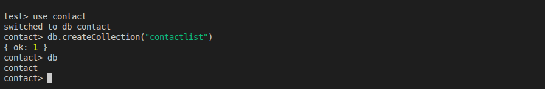
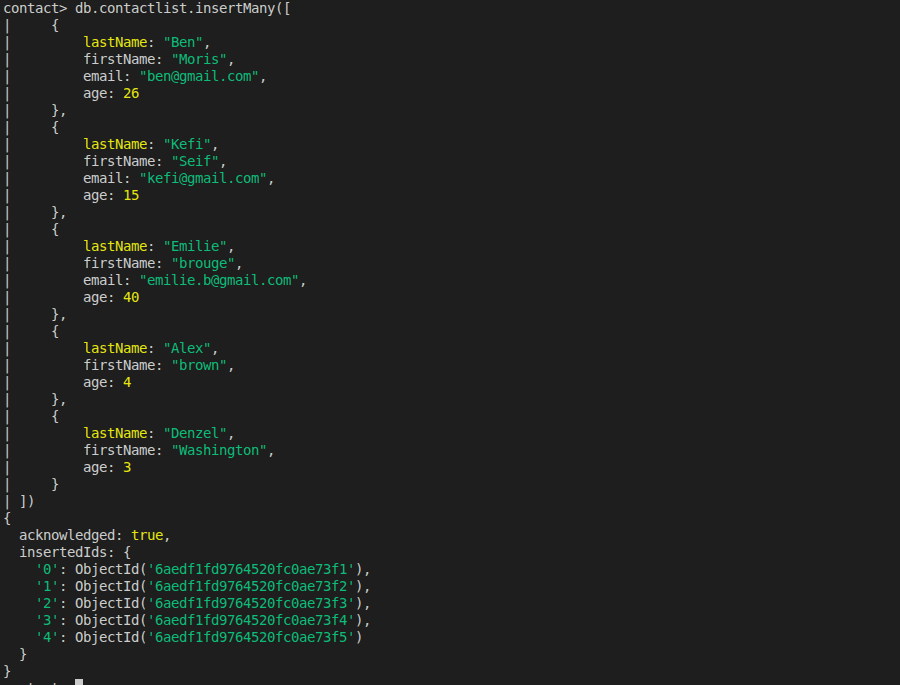
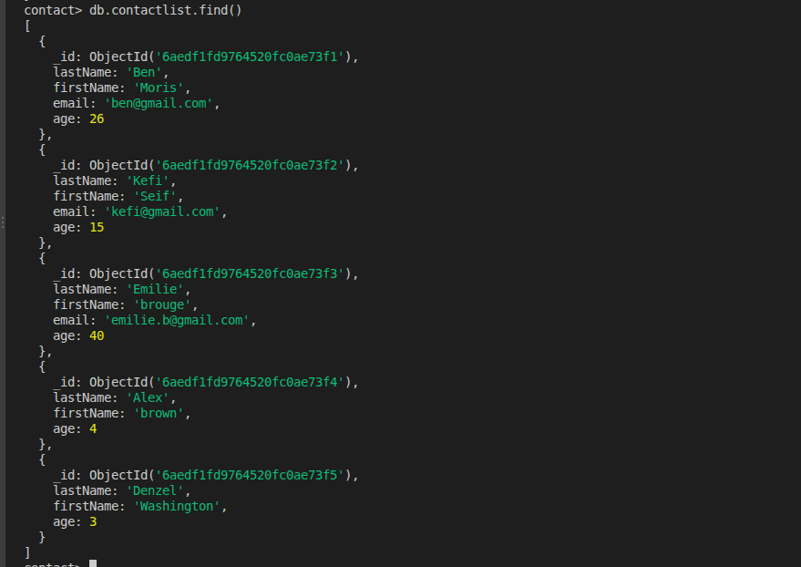
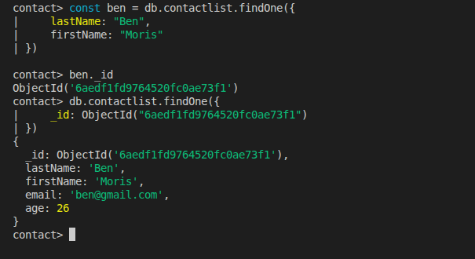
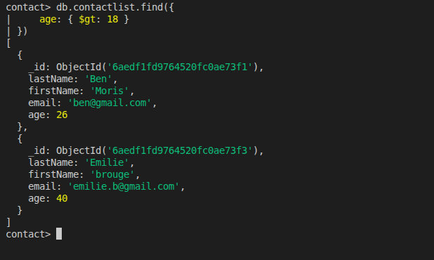
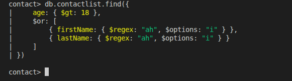
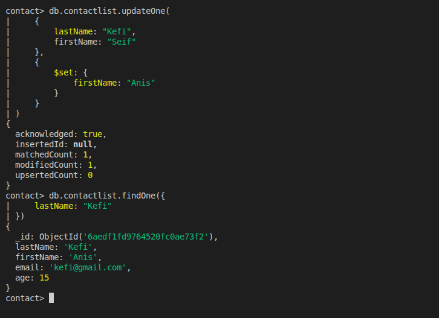
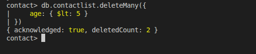
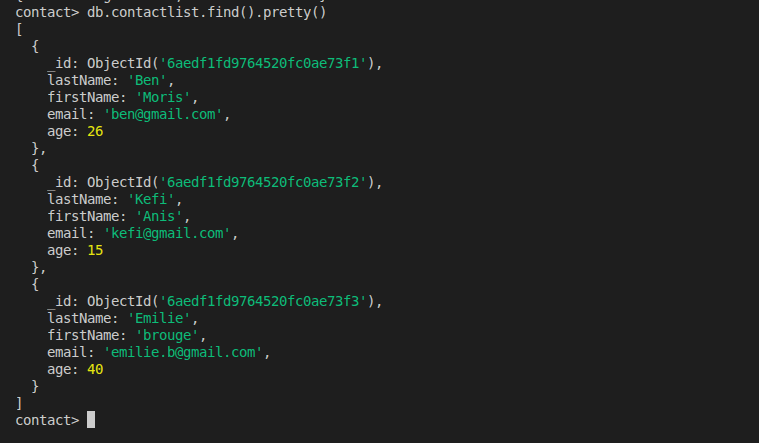

# GMC MongoDB CRUD Operations

## Introduction

This project demonstrates basic MongoDB CRUD operations using a contact management database.

The objective is to create a database and collection, insert contact documents, retrieve information using different queries, update a contact, and delete documents based on specific conditions.

## CRUD Operations

### 1. Create

Created the `contact` database and the `contactlist` collection.

### 2. Insert

Inserted five contact documents into the collection using `insertMany()`.

### 3. Read

Performed the following queries:

- Displayed all contacts.
- Retrieved one contact using its MongoDB `_id`.
- Retrieved contacts older than 18.
- Searched for contacts older than 18 whose first or last name contains `"ah"`.

The last query returned no documents because none of the provided names contains the consecutive characters `"ah"`.

### 4. Update

Updated the first name of the contact Kefi Seif to Anis using `updateOne()`.

### 5. Delete

Deleted all contacts younger than five using `deleteMany()`.

### 6. Final Result

After the update and deletion operations, three contacts remained in the collection.

## Screenshots

### 1. Database and Collection Creation

### 2. Insert Contacts

### 3. Display All Contacts

### 4. Find Contact by ID

### 5. Find Contacts Older Than 18

### 6. Find Names Containing AH

### 7. Update First Name

### 8. Delete Contacts Younger Than 5

### 9. Final Contact List

